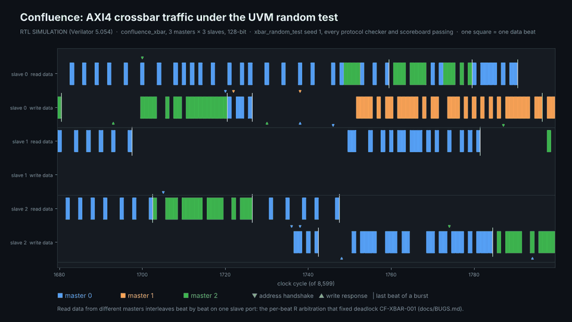
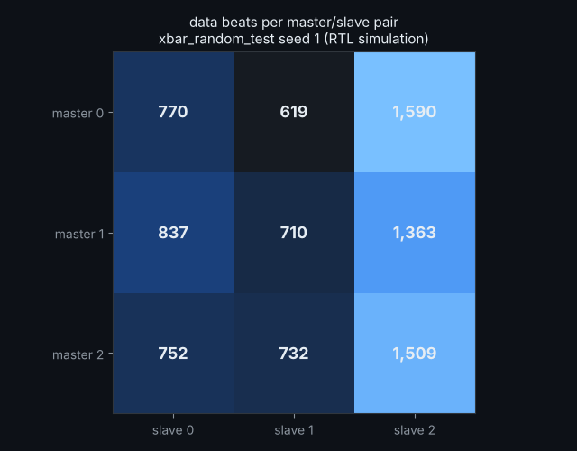

# Confluence

A heterogeneous ML SoC (Vortex-V RV64 host, NanoXL transformer accelerator, SpikeMesh
neuromorphic mesh, MLACC int8 IP on an AXI4 fabric) and its SystemVerilog/UVM verification
campaign: reusable protocol VIP, block-level environments reused vertically in a SoC
environment, SystemRDL registers, firmware-driven tests, formal on the fabric, performance
checks and coverage closure. Plan: [docs/PLAN.md](docs/PLAN.md). Conventions: [CLAUDE.md](CLAUDE.md).

## Status

| Milestone | State |
|---|---|
| M0 foundations (ADRs, toolchain, pinned IPs) | done |
| M1 VIP library: AXI4, AXI4-Lite, APB4, AXI4-Stream | done (26/26 AXI4 and 72/72 other self-tests) |
| M2 AXI4 crossbar `confluence_xbar`, bridges, crossbar formal | done; found and fixed deadlock CF-XBAR-001 |
| M3 SystemRDL register flow, RAL checks on every CSR block | done |
| M4 NanoXL block env, bit-exact vs NanoXL golden (W8A8, W4A8) | done |
| M5 SpikeMesh chip and router envs, credit-link VIP | done; found golden-model bug CF-SPIKE-001 (fixed upstream) |
| M6 Vortex-V on AXI through `vortex_axi_bridge`, lockstep with its ISS | done |
| M7+ SoC integration, firmware-driven tests, coverage closure | next |

Bugs found so far: [docs/BUGS.md](docs/BUGS.md). Mutation results: [docs/MUTATION.md](docs/MUTATION.md).

## Gallery



*Every data beat at the three slave ports of `confluence_xbar` during `xbar_random_test` seed 1, coloured by master, taken from a port-level FST of the run. This is **RTL simulation** (Verilator 5.054) with every protocol checker and scoreboard passing. Read data from different masters interleaves beat by beat on one port, which is the arbitration fix for deadlock CF-XBAR-001. [MP4](docs/media/xbar-traffic.mp4)*



Regenerate both with `scripts/media.py`. It builds the xbar bench with `+define+WAVES --trace-fst`, which needs `liblz4-dev`, and needs `fst2vcd` from gtkwave.

## Quick start

```
scripts/setup-toolchain.sh                 # Verilator 5.054, UVM, PeakRDL, submodules
python3 sim/regress.py sim/tests_vip.yaml  # VIP self-test regression
sim/run_uvm.sh axi4_selftest axi4_random_test 7
```
